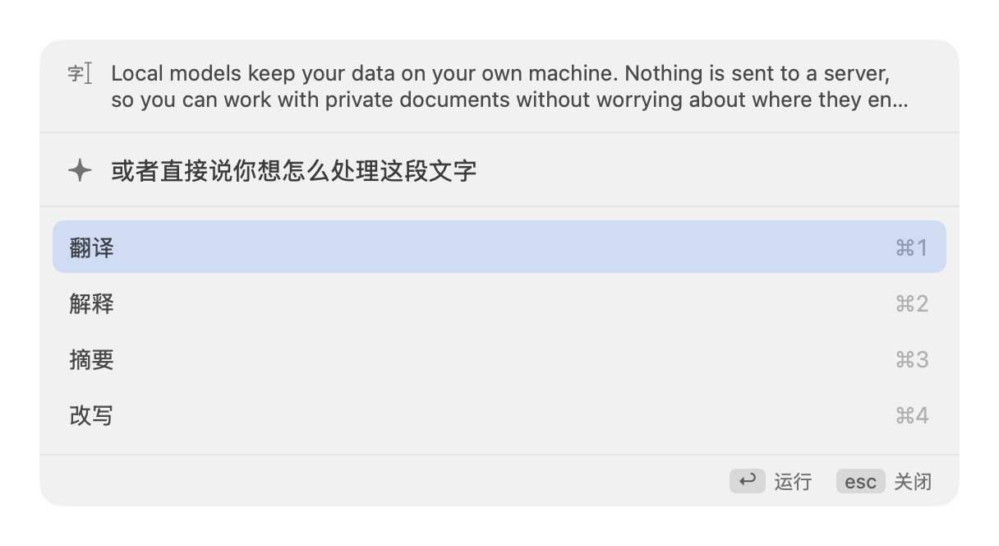
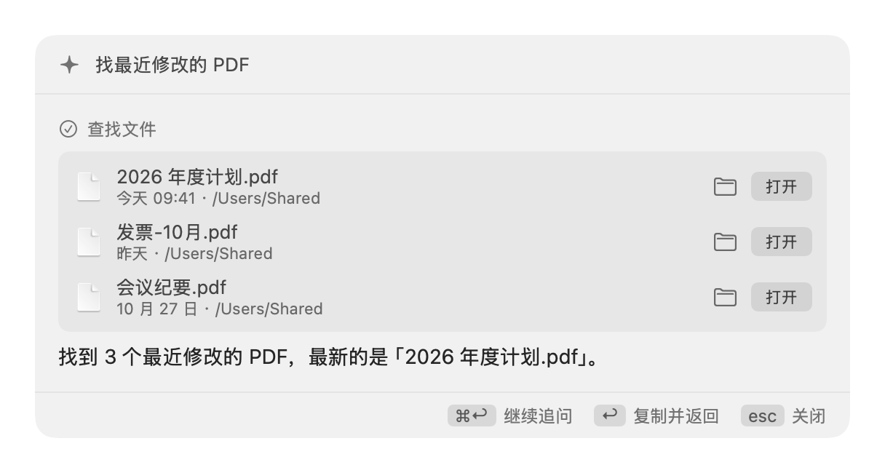

<h1 align="center">Aide</h1>
<p align="center"><strong>你的 Mac 上的本地 AI 入口。</strong><br>
按 <code>⌘⌃L</code>，说出想做的事——或先选中文字——它就帮你办好。<br>
只用你自己的 Ollama 模型，零上传。</p>

<p align="center"><strong>中文</strong> | <a href="README.md">English</a></p>

<p align="center">


</p>

<p align="center">
<picture><source media="(prefers-color-scheme: dark)" srcset="docs/assets/screenshots/quick-panel-actions-dark.png"></picture>&nbsp;&nbsp;<picture><source media="(prefers-color-scheme: dark)" srcset="docs/assets/screenshots/quick-panel-results-dark.png"></picture>
<br><sub>选中文字，选一个动作 &nbsp;·&nbsp; 说出想做的事，直接打开找到的文件</sub>
</p>

---

## 为什么用 Aide

多数 AI 工具要你去找它：开网页、粘贴、等待、再复制回来。Aide 反过来——它常驻菜单栏，直接在你正在用的应用上方打开，做完再把结果交还给原来的应用。

- **默认私密。** 只连本机的 [Ollama](https://ollama.com)。没有账号、没有云端、没有数据回传，对话只存在你 Mac 上的数据库里。
- **一个快捷键，两种用法。** 直接输入要做的事，或选中文字再选动作，都只要一次按键。
- **能动手，但不会瞒着你。** Aide 能找应用和文件、打开它们、读取和修改备忘录与提醒事项。凡是会改动数据的操作，都会先显示确切内容，等你同意才执行。
- **原生而安静。** SwiftUI/AppKit 应用，跟随浅色/深色模式和系统强调色。不占 Dock，不需要时不出现窗口。

## 你可以做什么

| 你 | Aide |
|---|---|
| 按 `⌘⌃L`，输入“打开备忘录”“找最近修改的 PDF”“备忘录有多少条” | 用本地桌面工具执行。找到的应用和文件显示成可直接打开、可在 Finder 中显示的条目。 |
| 在任意应用里选中文字，按 `⌘⌃L` | 选择**翻译**、**解释**、**摘要**、**改写**或你自己的动作；也可以直接输入自己的要求。 |
| 在回答上按 `⌘↩` | 转入工作区继续对话。 |
| 在回答上按 `↩` | 复制并回到原来的应用。 |
| 按 `⌘⌃S` 并框选区域 | 打开工作区新对话并附上截图（需要支持看图的模型）。 |
| 让它删除备忘录、追加备忘录内容或修改提醒 | 先显示将要执行的确切操作，你允许后才会执行。 |

### 快捷面板

最快的路径。一个小面板会在当前应用上方打开。

- 随意输入，中文等输入法不会被打断；输入时数字键和方向键就是普通文字。
- 用鼠标、`⌘1`–`⌘9`，或 `⌘↑` / `⌘↓` 加 `↩` 选择快捷动作。
- `Esc` 立刻停止正在生成的回答，输入框随即回来，可以马上问别的；旧回答不会混进新回答。
- 每次输入的请求都是独立的，不会带着前面的上下文。
- 如果在任务已经改动过数据后停止，Aide 会明确告诉你：已完成的操作不会撤销。

### 工作区

从菜单栏打开的完整窗口。

- 带搜索的历史对话，重新打开时原样恢复，包括找到的文件和应用。
- 流式 Markdown：表格、列表、带复制按钮的代码块。
- 重新生成回答、编辑上一条提问，按对话切换助手和模型。
- 长回答跟得上流式输出，窗口不卡顿。

### 助手与自定义动作

内置 5 个助手，也可以创建自己的：各自的系统提示词、模型、思考模式和采样参数。把常用的提示词做成自定义快捷动作，就是快捷面板上的一个按键。

## 安装

**要求：**macOS 14 或更高、Apple 芯片、已安装 [Ollama](https://ollama.com)。

1. 从 [Releases](https://github.com/liamamilin/aide/releases) 下载 `Aide-<版本>-arm64.dmg`，把 **Aide** 拖进“应用程序”。
2. 启动 Ollama 并拉取模型：
   ```bash
   ollama serve
   ollama pull qwen3:14b
   ```
3. 打开 Aide，它会出现在菜单栏。第一次使用时 macOS 会请求权限（见下）。

> **尚未公证。**目前没有 Developer ID 证书，下载的副本第一次会被 Gatekeeper 拦截。先打开一次，再到 系统设置 → 隐私与安全性 点**“仍要打开”**。或执行：
> ```bash
> xattr -dr com.apple.quarantine /Applications/Aide.app
> ```

暂无自动更新。更新时退出 Aide，用新版本替换“应用程序”里的旧版本即可。

### 权限

| 权限 | 用途 | 何时询问 |
|---|---|---|
| 辅助功能 | 读取你在其他应用里选中的文字 | 第一次带选区按 `⌘⌃L`。直接输入请求不需要它。 |
| 屏幕录制 | 截取你框选的区域 | 第一次按 `⌘⌃S` |
| 自动化（备忘录、提醒事项） | 你要求时读取或修改它们 | 第一次提出相关请求时 |

Release 的 DMG 是临时签名，更新后 macOS 可能再次询问。使用稳定身份签名的构建，权限在更新后会保留。

## 设置

菜单栏 → **设置…**（`⌘,`）

- Ollama 地址与思考模式
- 可录制的快捷面板快捷键
- 自定义助手与自定义快捷动作
- “高级”里的采样参数

## 隐私与安全

- **只在本地。**请求只发往你配置的 Ollama 地址，默认是你自己的电脑。
- **数据留在原地。**历史与附件位于 `~/Library/Application Support/ai-desktop-assistant/`，删除这个文件夹即清除全部。
- **改动前先确认。**删除或修改备忘录、提醒事项，都会先显示确切操作并等你同意。
- **结果如实呈现。**找到的文件和应用直接来自工具，不是模型的转述；文件已被移走时，打开会明确提示失败，而不是假装成功。

## 原生版暂未包含

桌面宠物、联网搜索和 Bash 工具目前仍在[旧版 Qt 应用](docs/legacy-qt.zh.md)中，两者共用同一份历史记录。

## 从源码构建

```bash
pip install -r requirements-dev.txt && pip install -e .
./scripts/build_native.sh --smoke      # dist/Aide.app 与 dist/Aide-<版本>-arm64.dmg
cd macos && swift test                 # Swift 测试，使用真实核心和假的 Ollama
```

需要 Xcode 15+ 和 Python 3.10+。从源码运行：`cd macos && swift run Aide`。

```bash
ruff check ai_desktop/ tests/ scripts/release_check.py
QT_QPA_PLATFORM=offscreen pytest tests/ -q
```

### 结构

原生 SwiftUI/AppKit 外壳（`macos/`）通过 stdio 上的 NDJSON 与不含 Qt 的 Python 核心（`ai_desktop/core`）通信。不开放任何网络端口，核心随应用退出。每一次模型对话和工具调用都走同一个运行引擎，每个工具有风险上限，任何破坏性操作都需确认。

更多：[macos/README.md](macos/README.md) · [`docs/` 设计笔记](docs/) · [CHANGELOG](CHANGELOG.md)

## 常见问题

- **“连不上 Ollama”**——运行 `ollama serve`，再检查设置里的地址。
- **`⌘⌃L` 没反应**——可能被其他应用占用，在设置里录制一个新的快捷键。
- **选中的文字没被读取**——到 系统设置 → 隐私与安全性 授予辅助功能权限；直接输入请求不需要它。
- **截图提问时模型无视图片**——换一个支持看图的模型。
- **更新后又询问权限**——临时签名的构建会这样，属正常现象。
